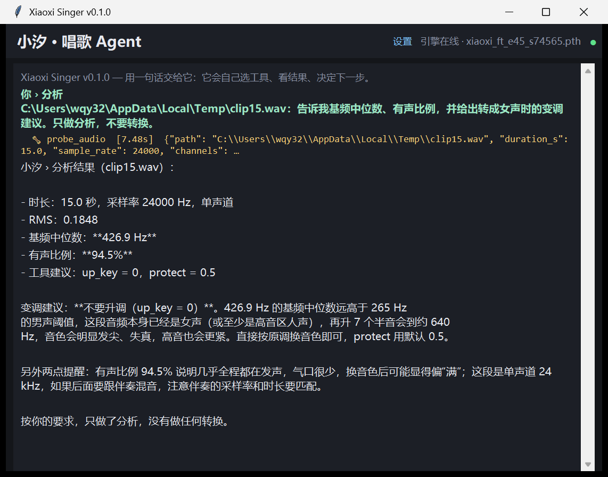

# xiaoxi-singer

**An agent that sings — not a checkpoint dump.**

Give it a song name and it does the whole job itself: search Bilibili, pick the official
upload, download the best audio track, separate vocals from the instrumental, convert the
vocal into a trained voice, post-process it, mix it, and hand back an mp3.

```
you:  唱一下《小幸运》
agent: [cover_song]  B站 搜到 4:48 的官方音源 → 分离 → 换声 → 后期 → 混音
       → runtime/demo_xiaoxingyun.mp3
        288.7 s · 24 kHz · RMS -14.6 dBFS · 峰值 0.917 · 升调 0 半音
```

It is not a model release. **No weights ship in this repository** — you bring your own
RVC `.pth` (yours, or one you trained), drop it in `models/`, and everything else here
turns that checkpoint into a working singing agent.



## What is in the box

| Layer | What it does |
|---|---|
| **Agent** (`agent.py`) | LLM loop over tools: `find_song` · `cover_song` · `probe_audio` · `convert_vocal` · `render_cover` · `mix_only`. It decides the transposition from measured f0, runs the pipeline, and explains what it did. |
| **Whole-song pipeline** (`song.py`) | search → download → MDX separation → convert → post → mix, with progress callbacks and resumable steps |
| **Voice engine** (`engine.py`) | chunked RVC conversion that survives an 8 GB GPU and does not drift, click, or hallucinate on silence |

| **QA** (`qa.py`) | after every render it compares the converted vocal with the source: dropped phrases, noise where the singer is silent, pitch drift, brittle top end, clipping — returned as `qa.verdict` / `qa.issues` |
| **Lyric video** (`video.py`) | cover art + burned subtitles (libass) → mp4; lyrics come from a `.lrc`, NetEase, or ASR, in that order |
| **Post / mix** (`post.py`, `mix.py`) | de-hum, exciter, de-harsh, silence gate, loudness-matched mix with a lookahead limiter |
| **Original songs** | ACE-Step generation → separate → convert → mix (`original.py`, `xiaoxi-singer compose`) |
| **Interfaces** | CLI, HTTP API, MCP server (so any agent runtime can call it), and a Tk desktop client |
| **Patches** | `patches/rvc-sweet-zone.patch` — the one upstream change that stops high notes from breaking |

Every render comes back with a self-check:

```json
{"verdict": "warn", "pitch_mae_semitones": 0.68,
 "dropped_spans": [[8.75, 9.25]], "clipping_samples": 0,
 "issues": ["有 2 段比源人声轻了 35dB 以上：[[8.75, 9.25]]"]}
```

`warn` means *listen to those timestamps*, not *the render is broken* — see
[docs/SONG.md](docs/SONG.md) for what each metric means.

## Quick start

```bash
pip install -e ".[song]"          # .[full] adds HTTP + MCP + song extras
export RVC_ROOT=/path/to/Retrieval-based-Voice-Conversion-WebUI
export XIAOXI_MODEL=/path/to/your_voice.pth

xiaoxi-singer song "周杰伦 晴天" -o qingtian.mp3      # whole song, no other input
xiaoxi-singer song "周杰伦 晴天" -o qingtian.mp3 --video   # + lyric mp4
xiaoxi-singer cover my_vocal.wav my_inst.wav -o cover.mp3   # you already have stems
xiaoxi-singer agent "把这段干声换成你的音色：/tmp/take.wav"
```

```jsonc
// MCP client config (Claude Desktop / DSH / any agent runtime)
{
  "mcpServers": {
    "xiaoxi-singer": {
      "command": "xiaoxi-singer",
      "args": ["mcp"],
      "env": { "RVC_ROOT": "/opt/rvc", "XIAOXI_MODEL": "/opt/models/xiaoxi_ft_e45_s74565.pth" }
    }
  }
}
```

---

## Why another RVC wrapper?

Because a raw voice-conversion checkpoint is not an *agent*: it OOMs on a whole song, drifts when you chunk it naively, hallucinates a 780 Hz tone on silence, turns spoken passages metallic, and returns an un-mixed vocal. This package is the ~700 lines of engineering that make a checkpoint behave like a service:

| Problem | What this package does |
|---|---|
| 8 GB GPU dies on a 4-minute song | fixed-slot chunking (30 s + 1 s overlap) onto a single time-indexed canvas, triangular cross-fades, exact original length |
| chunked output drifts / clicks | canvas placement instead of concatenation, 5 ms boundary fades |
| model sings a 780 Hz drone on silence | **source-referenced** silence gate: the source's own RMS envelope decides where output is muted |
| spoken intros become metallic | per-slice voicing analysis (`librosa.pyin`): low voicing + low f0 → raise `protect` to 0.9 for that slice only |
| male songs come out male | optional in-model transposition (`up_key`, +7 semitones is the sweet spot), applied **before** register clamping |
| high notes get thin / brittle | optional sweet-zone clamp (`RVC_SWEET=250,500`), auto-enabled only when the source's p95 f0 exceeds 500 Hz |
| brittle buzz on the top end | conservative post chain; the 4 kHz shelf is the single biggest buzz source and can be switched off |
| vocals sit on top of the band | loudness-aligned mixing: vocal matched to the original vocal stem's RMS, then limited and targeted |

## Architecture

```
                 ┌──────────────┐
  vocal stem ───▶│  RvcEngine   │  chunked RVC (GPU) + canvas + gate + spoken-aware protect
                 └──────┬───────┘
                        │ converted vocal
                 ┌──────▼───────┐
                 │    post      │  exciter / shelf / de-harsh / reverb / noise gate / limiter
                 └──────┬───────┘
 instrumental ──┐       │
                ▼       ▼
                 ┌──────────────┐
                 │     mix      │  RMS alignment + look-ahead limiter + 256 kbps mp3
                 └──────┬───────┘
                        ▼
                    cover.mp3

  interfaces:  cli.py  ·  server.py (FastAPI)  ·  mcp_server.py (MCP stdio)
  scheduling:  jobs.py (single worker — one GPU, one render)
```

## Install

```bash
git clone https://github.com/<you>/xiaoxi-singer && cd xiaoxi-singer

# 1) the RVC fork + the sweet-zone patch (only touches infer/vc/pipeline.py)
bash scripts/install_rvc.sh

# 2) upstream model weights (hubert / rmvpe / f0G40k) — see the script's output
#    HF mirror: https://hf-mirror.com/lj1995/VoiceConversionWebUI

# 3) this package
python -m pip install -e ".[server,mcp]"

# 4) point it at a voice + the RVC checkout
export RVC_ROOT=$PWD/vendor/Retrieval-based-Voice-Conversion-WebUI
export XIAOXI_MODEL=$PWD/models/xiaoxi_ft_e45_s74565.pth   # see MODEL_CARD.md
xiaoxi-singer info
```

### About the voice

`models/xiaoxi_ft_e45_s74565.pth` is an RVC v2 40k model fine-tuned on **6.6 h of isolated singing** (a public Mandarin singing corpus, a soprano subset of M4Singer, and 18 hand-picked pop/rock/folk songs), trained until an internal eval showed the vocal folds starting to loosen — epoch 45 of the fine-tune is the peak; going further made sibilance blurrier and high notes break more. Details, per-epoch metrics and failure modes: [MODEL_CARD.md](MODEL_CARD.md). Training recipe: [docs/TRAINING.md](docs/TRAINING.md).

A 20 s research demo (converted vocal, mixed with the original instrumental) lives in [`assets/demo/yuai_e45_20s.mp3`](assets/demo/yuai_e45_20s.mp3); rights to the underlying song remain with its owners, and it is included strictly as a technical sample.

The checkpoint is **not** in git (55 MB, and it is a voice). Drop your own RVC `.pth` into `models/` and set `XIAOXI_MODEL`; everything else is voice-agnostic.

## Usage

### CLI

```bash
# vocal only
xiaoxi-singer sing vocal.wav -o out.wav

# full cover (vocal + instrumental → mp3)
xiaoxi-singer cover vocal.wav inst.wav -o cover.mp3 --target-rms 0.118

# a male song sung by a female voice
xiaoxi-singer cover male_vocal.wav inst.wav -o cover.mp3 --up-key 7

# one sentence: it finds the song, separates it, sings it, mixes it
xiaoxi-singer song "小幸运" -o out.mp3 --video

# an original song, in the same voice
xiaoxi-singer compose "slow piano ballad, rain on a window" \
    --lyrics lyrics.txt --duration 90 -o song.mp3
```

### HTTP

```bash
xiaoxi-singer serve --port 8000
curl -X POST localhost:8000/v1/sing -H 'content-type: application/json' \
  -d '{"vocal":"vocal.wav","instrumental":"inst.wav","up_key":7,"target_rms":0.118}'
curl localhost:8000/v1/jobs/<job_id>
```

### MCP

Run `xiaoxi-singer mcp` (stdio). Tool calls return a `job_id` immediately; `sing_and_wait` blocks with a timeout. See [docs/MCP.md](docs/MCP.md) for a worked agent transcript.

## Desktop client

Not everyone wants a terminal. `client/desktop.py` is a ~430-line tkinter chat window: it starts
the local engine for you (`xiaoxi_singer.localapp`, loopback HTTP) and then just talks to the agent.


- **Download**: build once with `client/build_client.ps1` → `dist/XiaoxiSinger.exe` (~10 MB, windowed,
  no runtime bundled — it drives the Python environment you already installed)
- **Open**: double-click. The header shows `engine online · <model>`; if the engine is down the client
  starts it with the interpreter from its settings
- **Ask**: type a task (or attach a vocal / instrumental), watch tool calls stream in, then open the
  result from the *open output folder* button

See [docs/CLIENT.md](docs/CLIENT.md) for settings, packaging and troubleshooting.

## Tuning

Everything is an environment variable, so an agent (or you) can override per call.

| env | default | meaning |
|---|---|---|
| `RVC_ROOT` | `vendor/Retrieval-based-Voice-Conversion-WebUI` | RVC checkout |
| `XIAOXI_MODEL` | `models/xiaoxi_ft_e45_s74565.pth` | voice checkpoint |
| `RVC_UP_KEY` | `0` | semitones inside the model (+7 male→female, +12 octave) |
| `RVC_PROTECT` | `0.5` | articulation vs. timbre. Higher keeps more of the *source* pitch contour — raising it on transposed songs makes breaks worse |
| `RVC_RMS_MIX` | `0.5` | output loudness envelope vs. source. 1.0 imports the model's noise floor |
| `RVC_SPOKEN_PROTECT` | `0.9` | protect used on detected spoken slices |
| `RVC_SWEET` | *(auto)* | `250,500` clamps the register; `lo,hi,olo,ohi` remaps it in log space |
| `RVC_GATE_REF` / `RVC_GATE_DB` | `1` / `-50` | source-referenced silence gate |
| `POST_HF` / `POST_SHELF` / `POST_REVERB` / `POST_GATE` | `0.18` / `3` / `0.08` / `-40` | post chain |
| `FFMPEG` | `ffmpeg` | mp3 encoding |

## Limits (read before trusting it)

- Needs a GPU and a working RVC install; CPU conversion of a 4-minute song takes ~15 minutes.
- Input must be an **isolated vocal**. Separation is deliberately *not* bundled — use MDX-Net / Demucs yourself, and keep the instrumental stem for mixing.
- The model has a comfortable register around 250–500 Hz. Pushing it far outside that with `up_key` trades accuracy for range.
- Not a TTS. It converts a *performance*; it cannot invent phrasing.

## Ethics

This is a voice-conversion tool. Only convert voices you have the right to use, do not impersonate real people, and label synthetic vocals when you publish them. The bundled checkpoint is trained for research/demo use and is not cleared for commercial release.

## License

Code: MIT (see [LICENSE](LICENSE)). The RVC fork it depends on is MIT; upstream model weights keep their own licenses.
